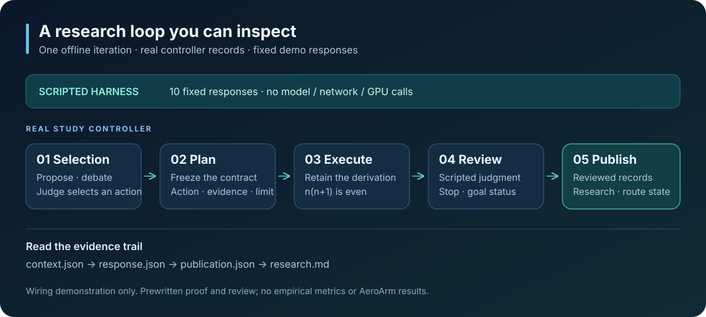
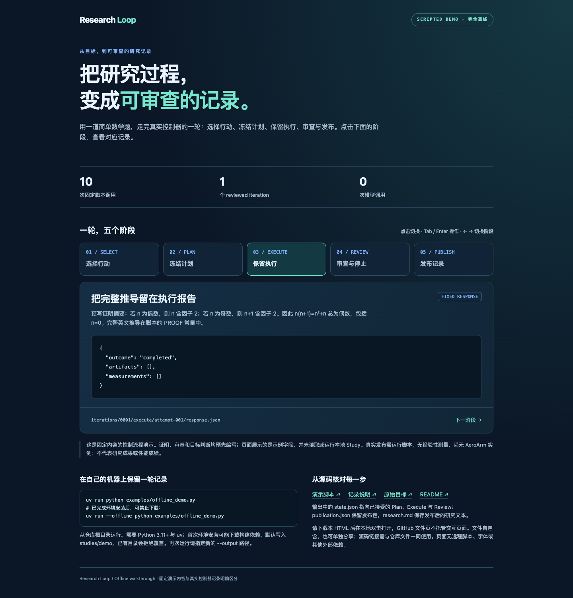

# Research Loop

**让研究进展留下可复核的证据。**

A document-based research controller for bounded experiments, independent review,
and recoverable execution. Built around your existing Codex or Pi CLI.



[快速体验](#快速体验) · [交互展示](docs/showcase.html) · [AeroArm 接入](docs/aeroarm.md) · [运行指南](docs/usage.md) · [MIT 许可](LICENSE)

Research Loop 把研究目标拆成有边界的调查：选择路线、冻结计划、执行、独立评审，再发布研究理解和候选。代码版本、评价协议、执行结果与判断一起保存，便于合作者检查结论和接续工作。

它适用于优化、诊断、复验、文献核查和推导。当前版本是研究原型；已有 Cactus 单次真实训练闭环记录，尚未证明跨任务研究收益。AeroArm 入口是接入模板，实际任务协议需由项目提供。

## 能做什么

| 能力 | 合作者得到什么 |
| --- | --- |
| 有界研究循环 | 明确的调用、时间和轮数预算；可选双提案辩论或直接选择 |
| 冻结调查合同 | 每轮固定输入版本、起点、权限、评价与停止条件 |
| 独立 Review | 执行完成、方法有效、知识变化和目标达成分别判断 |
| 实验图与 Frontier | 代码继承与证据引用分开；只比较同协议下已核查的精确候选 |
| 文档与恢复 | 两层研究文档、阶段回执和发布记录；保留中断现场供核对 |
| 可选扩展 | Scout、实时观测、人工任务队列、独立预算的长训练 |

控制器和研究后端分离：`src/research_loop/` 保存通用协议；`benchmarks/` 与 `integrations/` 保存任务边界。后端通过 prepare → start → inspect 分离准备、启动与同一执行的核对，接入方法见[执行后端指南](docs/execution-backends.md)。现有 ProTok 看板属于任务适配器，可作为实现参考；其[横向关系树、实验卡片与下方进展面板](integrations/protok/dashboard.md#阅读方式)统一展示正在进行和已完成的任务，并支持手机阅读。

可选 [Scout](docs/scout.md) 独立阅读论文与实现，提供外部洞见、反证和新视角。Reviewer 综合本地证据与未解问题，研究选择阶段决定下一步。宿主接入 Scout 后，默认每推进一轮且间隔至少五分钟可调用；结果在下一轮边界进入主循环，不改变当前 Plan。

## 快速体验

要求 Python 3.11+、[uv](https://docs.astral.sh/uv/) 和 Git，运行环境为 macOS/Linux。

也可以下载后直接用浏览器打开 [交互展示页](docs/showcase.html)，点击五个阶段查看示例记录；页面自包含，无需启动服务。GitHub 中的 HTML 链接显示源码，实际运行与字段说明见[展示导览](docs/showcase.md)。

<details>
<summary>查看交互展示预览</summary>



</details>

在仓库根目录运行：

```bash
uv sync --locked
uv run python examples/offline_demo.py
uv run research-loop status studies/demo
uv run research-loop graph studies/demo
```

离线演示不需要模型账号、GPU 或数据集。它用明确标记的脚本回复，走真实控制器的一轮选择 → Plan → Execute → Review → 发布，输出保存在 `studies/demo/`。**这验证流程接线，不是模型能力或 AeroArm 实验结果。** 已有目录不会被覆盖；完整说明见[展示导览](docs/showcase.md)。

## 使用真实 Agent

新 Study 使用 version 3。Plan 在 `markdown` 冻结科学合同，以顶层 `timeout_seconds` 限制执行；字段用途见[消费者审计](docs/plan-field-audit.md)。旧格式目录保留原样，不自动迁移，详见[使用说明](docs/usage.md)。

结构化输入输出由 Pydantic v2 模型统一定义，生成给现有 CLI 的 JSON Schema 并执行本地严格校验；安装或更新依赖使用 `uv sync --locked`。预算、作业、源码身份和核账仍由控制器判断。

尚未接纳的只读阶段输出若存在明确的参数错误，控制器保留原回复，将校验反馈返回同一阶段，在原任务和剩余调用/时间预算内修正。管线故障、身份或核账异常以及效果未知的作业继续阻断；输出校验失败不会自动重跑 Execute。ProTok 脚本请求在 claim 前检查入口文件、可修改源码与 Python 语法；明确的作者参数错误返回同一仍在运行的 Execute，在原 Plan 和剩余期限内修正。准备不分配计算资源，已提交或效果未知的作业不能由此重试。

ProTok 在接纳 Plan 前复用后端输入引用解析：未知来源、非法 checkpoint 引用、未来或未发布来源可在同一 Plan 阶段按原调用/时间预算修正。该检查只读本地配置和发布凭据；已发布证据损坏仍阻断，远端文件存在性留到执行准备检查，已接纳 Plan 不会被替换。

ProTok 的执行结案使用统一的 `--reconcile-execute` 入口：依据原执行记录确认未启动、已完成或已结算失败，在原 attempt 发布控制器回执；不重跑 Agent、不重提计算、不重置预算或 STOP。未知提交效果继续阻断，不兼容历史任务恢复。详见[后端约定](docs/execution-backends.md)。

先安装并登录本机 Codex 或 Pi CLI，再创建新 Study：

```bash
uv run research-loop init studies/proof \
  --goal examples/proof-goal.md \
  --harness codex --model gpt-6.1-sol --reasoning medium \
  --max-iterations 1 --max-calls 20 --max-seconds 900
uv run research-loop run studies/proof
uv run research-loop status studies/proof
```

`init` 不调用模型；`run` 会使用账号额度，最多推进一轮并受总预算限制。`status`、`graph`、`frontiers` 和 `knowledge` 为只读命令。支持的请求型号为 `gpt-6-astra`、`gpt-6.1-sol`、`gpt-6-luna`；实际可用性取决于客户端和账号，不会自动替换型号。

默认只读。需要修改实验代码时，通过 `--workspace` 指定干净的 Git 基线，并显式加 `--allow-write`。每次调查使用独立工作区。仅有 `run` 权限不等于已授权远程计算；训练资源与受保护评价器由任务后端管理。

详细参数、权限边界、评价 JSON、恢复及记录结构见[运行指南](docs/usage.md)。 Pi 的配置、验证和能力边界见 [Pi Harness](docs/pi-harness.md)。

## 在 AeroArm 中使用

先写清目标与允许范围，再固定开发评价和最终验收的边界：

1. 从 [AeroArm 目标模板](examples/aeroarm-goal.md) 开始，填入项目实际任务、数据角色与成功条件。
2. 按[接入指南](docs/aeroarm.md)连接项目自己的执行入口、评价器和结果回执。
3. 用小预算完成一轮真实执行与独立 Review，再扩展到正式研究。

模板中的目标是只读接入检查，不含假定的 AeroArm 指标，也不会启动训练。不要把通用的 [AUC 评价示例](examples/evaluation.json)直接当作 AeroArm 的评价协议。

## 读一轮研究记录

```text
study/
  goal.md / study.json / state.json   目标、配置与当前状态
  research.md / frontiers.json        当前理解与候选视图
  routes/                            路线知识与局部评价
  iterations/0001/
    context/                         本轮冻结输入
    plan.md / execute.md / review.md  计划、执行与评审
    publication.json                 实际发布清单
    plan|execute|review/attempt-001/  调用回执与原始输出
```

实时指标在 Review 前属于未评审观测；重试和同结果的转述不增加独立证据。中断恢复先核对外部效果，未知的远程作业不能直接重放。

## 文档地图

| 入口 | 内容 |
| --- | --- |
| [展示导览](docs/showcase.md) | 可运行的离线示例、流程图与阅读顺序 |
| [AeroArm 接入](docs/aeroarm.md) | 目标、评价边界、工作区和后端接口 |
| [设计规范](docs/evidence-driven-design.md) | Study、路线、调查、证据及 Frontier 语义 |
| [恢复](docs/recovery.md) / [失败诊断](docs/failure-diagnostics.md) | 阶段重入、未知效果和错误归属 |
| [人工任务](docs/task-queue.md) / [实时观测](docs/telemetry.md) | 操作员请求及观测接口 |
| [长训练](docs/long-training.md) / [Meta Loop](docs/meta-loop-design.md) | 可选研究扩展 |
| [Cactus](benchmarks/cactus/README.md) / [ProTok](integrations/protok/README.md) | 任务适配器参考及外部依赖 |
| [验证记录](docs/verification-v2.md) | 历史单次真实运行的设置、结果与限制 |
| [公开分发说明](docs/public-release.md) | 脱敏范围、历史边界及源码快照导出 |
| [PR Review](docs/pr-review.md) | Codex 自动评审设置、文档同步、脱敏与算法无关性规则 |

## 开发

```bash
uvx ruff check src tests benchmarks/cactus integrations examples
uv run python -m unittest discover -s tests -v
PYTHONPATH=src:tests:. uv run python -m unittest discover -s integrations/protok/tests -v
node --test integrations/protok/tests/dashboard.test.cjs
```

修改 Python 后，对改动文件运行 `uvx ruff format` 和 `uvx ruff check`。测试使用临时目录、固定回复或模拟传输；真实训练另行配置，测试通过不代表研究效果。

## 许可与共享

本项目使用 [MIT License](LICENSE)。随仓库提供的 KaTeX、markdown-it 等第三方资产保留各自许可，见 [THIRD_PARTY_NOTICES.md](THIRD_PARTY_NOTICES.md)。数据集、外部模型和任务仓库遵守各自许可与访问要求。

公开分支已移除私有研究输入及部署记录。已有 Git 历史仍保留旧版本；首次对外分发应使用[不携带历史的源码快照](docs/public-release.md)，完成历史处理前请保持原仓库私有。
