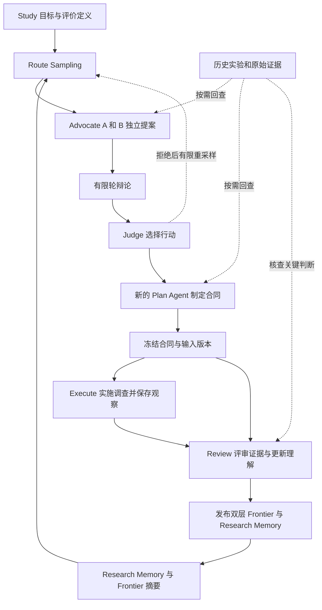

# 证据驱动的研究循环设计

状态：核心协议已实现，单轮真实接线已验证；研究收益待对照评估。日期：2026-11-01。实现边界与证据见 [v2 验证记录](verification-v2.md)。

研究循环由用户定义 Study 目标，Agent 自主探索 Route，并通过有边界的 iteration 获取证据。路线组织探索方向，实验节点保存调查及其结果，全局与路线 `research.md` 提供当前理解和证据入口。Global Frontier 评价整体研究成果，Local Frontier 指导路线内部的优化。

完整循环为：Study Goal → Route Selection → Plan → Execute → Review → Frontier / Research Memory Update → Route Selection。

## 研究语义

一次调查可以来自观察、经验、文献、失败记录或直觉。Plan 必须说明探索缘由、具体行动和判断结果的方法；假设与机制解释为可选内容。实验可以用于寻找改善、描绘趋势、检查适用边界、比较方法、诊断问题或完成目标要求的推导。

实用效果、经验规律和机制解释分别判断。方法在指定条件下有效，可以支持继续使用；解释其作用机制需要相应证据。数学证明只在目标要求证明时成为完成条件。

执行完成、方法有效、证据增强、目标达到和继续研究是不同判断。未发现反例本身不增加支持；有能力检出某项预期失败的实验未出现该失败，可以提供有条件的支持。缺失结果、调用失败与预算耗尽均不构成反证。

证据的强弱通过来源、实验条件、重复性、局限和相对其他解释的区分能力表述，不为所有研究定义统一分数或自动增长的置信度。

## 路线和实验节点

| 对象 | 定义 | 权威记录 |
| --- | --- | --- |
| Study | 用户定义的目标、Benchmark、全局评价、权限、数据角色、预算和成功条件 | `goal.md`、`study.json` |
| 路线 | Agent 探索的问题、可选假设、方法或局部目标，可以定义自己的局部评价 | `routes/index.json` 中的身份和状态，路线 `research.md` 中的研究理解及 `evaluation.json` 中的局部评价定义 |
| 实验节点 | 一次有边界的调查，保存计划、执行、评审及证据 | 对应 iteration 目录中的元数据和报告 |
| 产物版本 | 实验实际读取或产生的代码、配置、数据引用及其他结果的确定版本 | 实验节点中的输入与输出产物引用 |
| Attempt | 某个阶段的一次 CLI 调用 | 该阶段的 attempt 目录 |
| Frontier | 在指定评价定义和可比性范围内，已核查候选的非支配集合 | `frontiers.json` 中的可重建视图；对应实验结果和证据仍是权威来源 |

Iteration 是控制器推进一次调查的时间序号，包含路线选择，至多形成一个实验节点。节点直接保存在 `iterations/<轮号>/`，使用轮号作为 ID。仅停止或拒绝行动的 iteration 保留选择与已产生的 Plan 记录，不进入实验图。

有意复验创建新节点，并引用被复验节点。因调用失败而重试创建新 attempt；重试记录不作为额外的独立实验。

### 图关系

每个实验节点记录：

| 字段 | 含义 |
| --- | --- |
| `route_id` | 本次主要推进的路线 |
| `base_experiment` | 主要继承的历史节点；首次调查或独立调查可为空 |
| `references` | 本次采用的其他历史实验、引用用途及实际使用阶段 |
| `input_artifacts` | 实际输入版本及其用途，包括比较基线 |
| `output_artifacts` | 实际产生的版本、结果及其用途 |
| `evaluation_refs` | 本次采用的全局与局部评价定义、版本及可比性范围；没有局部优化目标时局部引用可为空 |

`base_experiment` 和 `references` 指向本轮开始前已发布 Review 的历史节点，形成有向无环图。轮号的前后关系只表示时间，不自动建立继承关系。Plan 冻结当时的引用集合；后续阶段采用的其他证据补充到节点引用中并标明阶段，不改写既定合同。

主要起点可以属于另一条路线。引用其他路线的结果不自动继承其代码，也不意味着该结果支持本次结论。融合多个候选时，Plan 必须列明实际输入版本，融合结果作为新产物重新评价。

对于代码实验，控制器在 Execute 前准备与输入版本一致的独立工作区，保留其他节点和用户现有工作。版本引用必须覆盖实验依赖的代码与配置；未提交文件、外部数据和检查点须有明确引用。无法恢复所需起点时停止该调查，不使用当前工作区猜测替代。纯观察或文献调查可以没有可写候选版本。

### 路线状态

路线状态存于索引：`active` 表示可继续调查，`paused` 表示暂缓，`closed` 表示当前探索问题已结束。暂停和关闭记录原因；暂停还记录恢复条件。状态不表示某项解释为真或为假。

索引记录路线 ID、简短主题、状态、状态原因、恢复条件、当前研究文档及局部评价定义的固定引用。路线成员由实验节点的 `route_id` 确定；被采样和被选中执行的历史从 Route Selection 记录取得。

Route Selection 可以提出创建或重新激活路线。Judge 选中行动并由 Plan 确认可执行后，控制器分配或引用路线 ID，将初始文档和状态变更暂存于本轮；它们随 Review 正式发布，期间不改写轮初索引。新路线的初始文档只包含问题、探索缘由与已有证据引用。Review 更新所选路线的状态；某个候选被支配不构成关闭路线的充分理由。

## 证据记录

证据以实验报告、实际输出、产物和精确外部来源为依据。研究文档中的每项重要判断保留以下内容：

- 观察或结论，以及它属于实用效果、经验趋势还是可选的解释。
- 成立的条件，包括相关的版本、评价方法、数据角色和资源范围。
- 支持、挑战或限制该判断的具体来源。
- 当前仍然未知的部分，以及据此采取的行动。

重复总结、不同 Agent 转述同一次结果均不形成新证据。重复运行、扩大条件覆盖和事先提出的预测得到满足，可以增加支持；必须说明共享数据、共用运行结果或其他相关性。

数值结果记录单位、比较对象和评价条件。效果处于已知波动范围内时记录为尚未区分。条件不同的结果保留各自范围；冲突未解决时同时保留，不通过摘要合并消除。

## 指标和双层 Frontier

### 评价定义

Study 初始化时由用户给出全局目标、Benchmark、权威评价协议、一个或多个目标指标、约束和成功条件。指标定义包含名称与含义、方向、单位、计算或聚合方式、数据角色、比较基线，以及需要固定和允许变化的评价条件。成本和资源可作为用户指定的目标维度，也可作为可行性约束；两种用途必须明确。

每项评价有确定的定义版本和可比性范围。范围明确数据与划分、评价器版本、资源或硬件条件、重复测量与 checkpoint 选择规则等与比较有关的条件。指标相同但条件不兼容的结果分开保存；允许变化的实验因素不因取值不同而自动成为不同范围。

Study 明确哪些评价可反馈给持续搜索、哪些仅用于最终验收。仅限最终验收的结果及其派生 Frontier 不传入 Route Selection 或 Plan；搜索可见的评价范围也不能替代最终完成条件。

Plan 可以提出 Route 的局部指标，标注其优化、比较或诊断用途，必要时一项指标兼有多种用途。只有局部评价定义中明确列为优化目标的指标参与 Local Frontier 支配比较；观察指标用于解释和判断，约束用于筛选可行候选。

新增局部优化目标或实质改变目标集合、指标定义、聚合方式、数据角色或评价协议时，创建独立的局部评价版本或可比性范围。新定义先随 Plan 固化，在 Review 发布时登记为路线可用定义。仅增加诊断指标且不改变优化目标和比较协议时，无须另建 Local Frontier。旧定义和结果保持原状，旧产物只有在获得新定义下有效的评价记录后才能进入新范围。

全局评价定义只能通过用户明确的 Study 级修订更新。修订在空闲时产生新版本，保留原定义和对应结果；后续选择与合同使用新版本。Route Selection、Plan 和 Review 均无权将局部指标提升为全局目标或事后改写成功条件。

### 候选与支配关系

Frontier 候选是已发布 Review 核查过的实验产物，身份包含实验节点、准确产物或 checkpoint 版本、评价定义版本和可比性范围，并链接实际评价记录。同一实验可以产生多个候选，但每个候选必须有与自身版本对应的完整评价，不能拼接不同 checkpoint 的最好指标。

一个候选进入比较前必须具备该范围所有目标与约束所需的有效结果。缺失评价、不可比或未核查的候选保留为未入选记录，不用零分替代；违反约束的候选不进入该 Frontier。相同产物的重复测量按预定协议聚合，不将每次测量波动作为独立候选择优。

在同一范围的可行候选中，若 A 按指定方向在所有目标上都不差于 B，且至少一项严格更好，则 A 支配 B。多目标 Frontier 保留未被任何候选支配的集合；单目标退化为最优候选集合，相同评价值可以并存。采用合同规定的聚合值和数值精度比较，不临时引入加权总分。

Frontier 成员变化描述按协议得到的数值排序，不能自动证明差异显著、机制成立或目标已经达到。Review 另行表述波动和证据局限。候选被移出 Frontier 后，其实验、版本和证据继续保留，并可被后续行动选为起点。

### Global Frontier

Global Frontier 按 Study 的全局评价版本和可比性范围组织。所有路线中满足该全局评价要求的实验产物都可参与更新。它保存非支配候选及其准确版本、目标值、约束结果、评价条件和证据引用。

全局主指标和成功条件决定 Study 的实质进展与完成判断。存在多目标取舍时，Review 分别报告各指标变化和约束是否满足，不擅自将某个取舍定义为整体最优。Global Frontier 不决定路线优先级，也不是路线采样的唯一来源。

### Local Frontier

Local Frontier 按 Route、局部评价版本和可比性范围组织，收录推进该路线的实验候选。某条路线可以保留多个范围的 Frontier，当前 Plan 明确使用其中哪一个。引用其他路线的候选可用于设计行动；若要在本路线比较，必须建立绑定准确产物、符合本地评价定义的实验评价记录。

不同路线可以分别优化任务表现、参数量、收敛速度等目标，或观察 Pointwise MSE、分时段 Velocity Error、采样轨迹误差等诊断量。诊断量只有被事先列为局部优化目标时才成为 Frontier 维度。不同 Local Frontier 不直接进行数值排名，也不修改 Global Frontier 的定义。

一次实验可能只具备全局、只具备局部、同时具备两种入选资格，或都不具备。两种 Frontier 分别判断。诊断、理论和文献调查可以没有可排序的产物或局部目标，照常形成证据与研究理解；Study 的定性完成条件也无需被强制转换为分数。

### 更新与反馈

Execute 保存实际评价结果；Review 核查资格、条件和来源，记录每个候选对各范围的纳入或排除依据；控制器根据核查记录与固定定义计算支配关系并发布视图。训练日志和 Agent 自报的“最好结果”不能直接修改 Frontier。

两种 Frontier 均可由评价定义、已发布的实验评价与核查记录重建。纠正或撤销评价时，重新计算受影响范围，考虑所有仍有效的历史候选，包括此前被支配的候选。保留纠正依据，不删除原始结果；重建使用小型评价记录和版本引用，不为维护视图全量扫描原始日志、数据或检查点。

Frontier 向下一次 Route Selection 提供已有表现、成本取舍与可用起点；Research Memory 提供负结果、冲突、研究机会及尚未解决的问题。尚未进入 Frontier 的路线仍可有较高探索价值。

## 阶段职责和上下文

每个阶段使用新的 CLI 会话。控制器传入基础上下文、固定引用与任务合同，Agent 按需读取补充证据。隐藏会话历史不承担持久状态。



| 阶段 | 默认上下文 | 按需读取 | 主要输出 |
| --- | --- | --- | --- |
| Route Sampling | Study 目标与全局评价、全局文档、路线索引、剩余预算、采样历史及必要 Frontier 摘要 | 可恢复路线的机会引用 | 固定的候选及采样记录 |
| Advocate A / B | 共同的 Study 目标和全局上下文，各自路线文档、局部评价、Local Frontier、预算；辩论轮次附对方论点 | 自身行动和质疑所需的历史证据 | 一项具体行动提案及有限轮质疑、回应 |
| Judge | Study 条件、全局上下文、两个提案、辩论记录、相关 Frontier 和预算 | 决定选择的关键证据 | 选择行动、重采样或停止及其理由 |
| Plan | Study 目标与评价、权限、剩余预算、Judge 选中行动及理由、全局文档、所选路线文档与 Local Frontier | 起点节点、定义版本、提案依据和局部指标所需证据 | 可执行调查合同，或无法落实的原因 |
| Execute | 目标、调查合同、所选路线快照、确定的输入版本和合同引用的相关证据 | 完成调查或核实前提所需的历史记录 | 实际操作、观察、偏离、失败和产物引用 |
| Review | Study 目标与评价、Plan、Execute、更新前的两层文档、有关 Frontier 与局部定义、路线状态及已用预算 | 起点与对比实验、支撑关键判断的实际输出 | 本地证据核查、跨实验解释与未解问题，全局与局部评价、Frontier 更新依据、两份新文档及后续决定 |
| Scout（异步） | 大目标、完整路线目录、有界的研究记录、已发布 Review 洞见及上次调研 | 冻结源码摘录、只读外部论文和实现 | 有来源的解释、反证、新视角、适用条件和未解问题；实验建议可选 |

Scout 通过外部知识独立审视本地解释，也可提出 Reviewer 尚未提出的问题。Advocate 将相关洞见转为行动提案，Judge 说明采纳、暂缓或拒绝的重要依据。异步报告在下一轮边界冻结，不改写当前调查。具体输出、上下文和频率见 [Scout](scout.md)。

目标与用户约束决定权限和完成条件；Plan 限定本次执行范围。研究文档、历史报告和外部资料提供证据，不能扩大权限或改写目标。Advocate 与 Judge 的观点属于决策记录，不形成新增实验证据。

## Route Selection

Route Selection Policy 是 Plan 之前可替换的选择步骤。输入为本轮固定的研究状态与预算，输出为选中行动及理由、重新采样或停止。默认采用 Route Sampling → Advocate A / Advocate B → Debate → Judge；这些角色按需调用现有 CLI 后端，使用只读权限和有界上下文。

### 候选采样

默认把 `active` 路线与一个“新路线机会”放入洗牌轮转队列，每次无放回取两个不同候选，队列耗尽后再打乱。队尾只剩一个时先取该候选，再从新队列中取一个不同候选补足；新队列内与本次已取候选重复的项留待以后抽取。新路线机会允许提出新方向，或依据新证据提议恢复暂停、关闭的路线。记录随机种子、队列位置及已抽取候选，新增或失效路线在下一次采样时更新队列。

`active` 路线只有一条时，使用该路线与新路线机会；没有 `active` 路线时，两位 Advocate 独立提出起始或恢复路线。新路线提案从公共目标、全局理解与研究机会出发，尚无 Local Frontier。被拒绝的提案只保留在选择记录中，不自动注册。新路线机会进入候选不强制创建路线。

队列使已有路线周期性重新进入候选，避免只因未在 Frontier 中就失去曝光。被采样与被选中执行分别记录；公平曝光不要求平均分配执行预算。默认采样不按 Frontier 排名淘汰路线，Frontier 信息交给提案与 Judge 使用。

### 提案与辩论

两位 Advocate 首先在独立上下文中，各自提出当前最值得执行的一项具体行动，说明探索缘由、候选起点、预期研究价值、拟采用或新增的评价、成本、关键风险与证据缺口。行动可以是优化、诊断、复验、跨路线比较或其他有限调查。局部指标只需提出用途，完整定义由 Plan 完成。

初始提案完成后，双方轮流质疑和回应。默认一轮，每位 Advocate 各有一次质疑与一次回应；顺序记录在案。每次调用只接收共同约束、两个提案、本路线上下文、当轮所需的质疑与回应及来源引用。记录完整发言，但不累积共享的无限会话。

质疑围绕行动能带来什么、证据是否适用、成本是否合理、风险能否控制。回应可以修订提案，并明确变化；Judge 评价最终提案。辩论中的预期收益与机制推测保持未验证状态。

### Judge 和行动交接

Judge 按以下依据比较行动：

1. 对研究目标或当前使用决策的价值。
2. 可能获得的有效改善，或减少关键不确定性的能力。
3. 当前工具、证据与剩余预算下的可执行性和成本。
4. 已有投入、重复尝试和停滞情况。

会使多个路线的比较失去意义的已知问题优先处理。没有这类阻断时，可以直接追求有希望的改善，不要求每次调查都区分机制。暂时效果较差的路线仍可因探索价值被选择；当前效果最好的节点不自动获得下一轮预算。

Judge 记录选择理由和未选提案的不足，输出 `select`、`resample` 或 `stop`。选择绑定具体提案及其修订、路线或新路线说明、候选起点和必要证据，不仅返回路线名称。局部指标不同的行动通过研究价值、证据和成本比较，不将不同 Local Frontier 的数值直接排序。

两个提案都不值得执行时可以重采样；目标已达到、预算不足或需要人参与时可以停止。拒绝两个提案不能推出所有路线都无价值。默认一轮辩论、最多一次重采样，均可在 Study 的选择预算内配置；所有调用与重采样消耗总预算。每次调用前检查剩余预算，选择预算不能透支本轮为调查与评审保留的资源。额度耗尽时停止当前有界运行并记录选择预算原因，不据此宣告目标完成。

选中行动传递给新的 Plan Agent。Plan 可以完善或缩小行动至可执行范围；若关键前提不成立、需要改变研究意图或换路线，应返回原因，重新进入受同一预算限制的 Route Selection，不能静默替换 Judge 的选择。Plan 返回选择步骤也计入同一个重采样限额，已用预算不重置。

进入 Execute 前可在本 iteration 内重选，保留被拒绝的提案与 Plan attempts，并明确最终采用的合同引用。进入 Execute 后，本节点的行动身份固定；需要另做调查时先保存本次结果与限制，完成可发布的 Review，再由新的 iteration 选择行动。

## Plan

Plan 读取 Study 的全局目标和评价要求、Judge 选中行动、所选路线的研究理解、Local Frontier 和相关局部定义，回查起点实验及提案所依赖的证据。新路线先读取其问题说明与来源。

Plan 将行动落实为一次有限调查，可以定义新的局部指标或沿用既有评价。诊断、理论、文献调查和直接性能优化都可形成合同，不要求机制假设，也不要求每次建立 Local Frontier。全局任务完成条件保持 Study 定义。

### 调查合同

Plan 输出以下合同，控制器在执行前冻结：

| 内容 | 要求 |
| --- | --- |
| 探索缘由 | 为什么值得开展本次调查，引用已有依据并标明直觉或推测 |
| 路线和起点 | Judge 选中提案、路线、主要起点、相关历史节点、实际输入版本 |
| 有限行动 | 做什么、允许调整什么、哪些条件保持固定 |
| 全局评价 | 引用 Study 定义与可比性范围，明确本次如何取得所需全局结果，或为何不适用、无法完成 |
| 局部评价 | 沿用或提出局部定义，标明优化、比较、诊断用途；确定 Frontier 目标、约束和观察量 |
| 结果记录 | 指标定义、方向、单位、数据角色、比较基线、评价条件、重复与 checkpoint 选择规则及来源要求 |
| 决策条件 | 哪些结果值得继续、暂缓或停止；如何处理波动、无改善和缺失结果 |
| 证据产物 | 需保存的结果、条件和可定位引用 |
| 资源边界 | 本轮时间、计算、调用等预算及中止条件 |

假设、预测和机制解释按需附加。定性调查说明判断依据与证据标准；优化调查明确改善标准。复验次数和精度应由预期波动、决策需要及预算确定，不强制所有实验执行相同的检验。

评价规则必须先于本次结果确定。看到结果后提出的新解释或标准记为探索性发现，后续再安排验证。

## Execute

Execute 从指定输入版本实施合同，可以包含多个相互连贯的工具操作。默认传入所选路线全文和本次相关的全局结论摘录；摘录保留来源、条件和限制。

执行报告记录实际输入、条件、操作、结果、资源消耗、偏离合同的部分、失败和未完成项，并给出原始结果与输出版本的位置。执行完成状态为 `completed` 或 `incomplete`，只描述合同实施情况。

执行中可以回查缺失条件、历史错误和冲突结果。合同允许的局部调整记录后执行；起点错误、关键前提失效、需要修改评价规则或扩大权限时，保留已发生的事实，停止依赖该前提的行动，交由 Review 或人处理。

Execute 只能在授权工作区保存本次独有的产物，不能覆盖旧证据、研究文档或控制记录。额外观察可以报告，但不能冒充预先约定的验证。

训练类实验按 Study 的权威协议取得可比较的全局指标，同时计算合同约定的局部指标。受预算或工具限制未完成某项评价时，明确记录缺失及原因，该结果不能进入相应 Frontier；局部诊断仍可形成有效证据。

训练期间可持续输出指标、曲线和中间观察。每项测量绑定名称、值、单位、训练 step、checkpoint 或可定位运行状态、配置、数据与划分、随机种子、评价定义和条件。无法恢复到准确产物版本的中间观察只作为观察证据。原始日志、最终评价及必要的中间产物引用均保留。

结构化测量及其证据引用随 Execute 的 `response.json` 保存，报告描述其含义。流式日志不直接更新 Frontier；进入候选集合需要 Review 核查完整评价及版本。非训练调查继续使用适合问题的证据形式。

## Review

Review 对照合同检查实际执行，核查会影响下一步行动或目标判断的证据。证据可以来自有限实验、观察或推导；核查深度应匹配拟作结论。

Review 分别处理 Global Evaluation、Local Evaluation 和 Research Memory Update：

| 判断 | 内容 |
| --- | --- |
| 执行情况 | 完成了什么，是否偏离合同，哪些结果有效或无法比较 |
| Global Evaluation | 是否满足 Study 全局评价与约束、各主指标是否改善、候选能否参与 Global Frontier 更新及其依据 |
| Local Evaluation | 是否满足相应局部定义、局部目标与诊断量如何变化、候选能否参与该范围的 Local Frontier 更新，以及路线的后续价值 |
| Research Memory Update | 哪些判断增强、受到挑战或保持未决；保留发现、负结果、局限、冲突、来源和影响路线选择的机会 |
| 解释状态 | 若涉及机制，说明实际检验了什么；可以保持未知 |
| 目标状态 | `met`、`not_met` 或 `undetermined`，依据目标原有条件 |
| 后续决定 | 继续或停止、路线状态、仍值得调查的问题 |

没有预设假设的调查可以正常完成评审。对新出现的解释标注其事后性质。“未被挑战”与“支持增强”分别表述；不因缺少明显反对而自动提升可信度，也不因机制未知而否定有条件的实用效果。

Review 在结构化返回中记录候选、测量与定义引用，分别给出全局和局部的有效性、可比性、约束结果及排除原因，供控制器维护对应 Frontier。缺少全局结果不按“全局退化”处理，局部改善也不按“全局改善”处理。局部诊断有价值但全局表现较差的实验，仍可提高路线的探索价值。

Review 返回本次知识变化及其来源、完整新版路线文档、完整新版全局文档和路线状态变更。没有全局影响时全局文档可以保持原文。Frontier 表现与研究价值分别判断，不能仅因候选被支配就关闭路线。下一步机会交给后续 Route Selection，不预先锁定下一轮。

Review 保持只读；需要新运行才能解决的问题，应成为后续调查。另开一次模型会话本身不形成独立实验验证。

## 研究文档更新

### 路线 research.md

路线文档保存：

- 核心问题与探索缘由。
- 当前观察、工作判断及可选解释，各自附条件、来源和限制。
- 局部评价与对应 Frontier 的引用，以及指标变化对本路线的意义。
- 对后续选择仍有价值的负结果与失败经验。
- 尚未解决的问题和可能的下一步行动。

每次 Review 纳入新增证据，修订或撤回受影响判断，保留仍然有效的知识。详细操作与完整结果留在实验记录中；压缩文档时保留影响决策的反例、条件和证据入口。

路线文档综合该路线截至本次的研究理解，不等于起点实验的旧摘要，也不指示工作区版本。当前文档发布到 `routes/<路线 ID>/research.md`；本次更新前后分别保存在节点的 `context/route.before.md` 和 `route.after.md`。

### 全局 research.md

全局文档保存：

- 目标进展与当前可采取的行动。
- Study 全局评价与 Global Frontier 的引用，以及全局成果和成本取舍。
- 对整体研究重要的结论、趋势和适用条件。
- 跨路线的冲突、一致性、共同约束和关键未知项。
- 影响路线选择的问题与证据引用。

结果改变目标判断、其他路线的解释或实验设计、探索优先级或全局约束时，进入全局文档。关键诊断发现可以在没有 Frontier 改善时进入全局文档。局部实现细节保留在路线和节点。完整路线名录及状态以索引为准，全局文档只讨论影响当前决策的路线。两层文档引用 Frontier 并解释其研究意义，不复制维护第二套候选和指标数值表。

Review 更新所选路线和全局文档。涉及其他路线时，全局文档明确写出受影响路线、旧判断及新证据，保留未解决冲突。后续 Advocate、Judge 和 Plan 使用该路线前必须结合这些更新；下一次该路线 Review 再同步其文档。不能把其他路线尚未更新的摘要当作冲突已经消失。

当前全局文档发布到根目录 `research.md`；本次更新前后分别保存为 `context/global.before.md` 和 `global.after.md`。结论被纠正时保留原实验记录，由新评审和当前文档指出纠正关系。

## 原始记录回查

默认沿引用逐层读取：研究文档 → 实验 Review 与 Execute → 相关结果、日志片段、代码或推导。已有报告足以回答问题时停止深入。

| 触发条件 | 必须核查的内容 |
| --- | --- |
| 从旧节点继续或融合候选 | 起点、输入版本、必要条件和历史限制 |
| 将历史结果用于决定本次行动 | 与决策相关的条件和关键证据；可直接采用之前已核查且条件仍适用的精确引用 |
| 出现矛盾或异常改善 | 对比实验的方法、版本、评价条件和产生分歧的实际结果 |
| 准备宣告目标达到、排除某种解释或扩大结论范围 | 支撑该判断的实际证据和范围限制 |
| 准备纳入 Frontier 或修改其评价依据 | 对应产物的完整测量、定义版本、可比性条件、约束结果与原始结果引用 |
| 怀疑重复旧失败或摘要丢失信息 | 原计划、失败输出及相关 Review |
| 修订或撤回已有结论 | 原结论来源、新证据及具体错误位置 |

找不到关键来源时降低判断强度并记录缺口。访问原始记录按问题限定范围；不为恢复上下文扫描或哈希整个数据集、缓存、检查点和日志历史。需要新增计算或昂贵复验时，由后续 Plan 给出预算，不能混入上下文读取。

## 快照和发布协议

每次调用保存实际提示词、默认文档快照及引用清单。清单记录来源路径、修订或发布引用和用途；额外工具读取保留在 CLI 记录中，报告列明被实际用于判断的来源。

本轮开始时冻结 Study 目标、全局评价、研究文档、路线索引和所需 Frontier 视图版本，供 Route Selection 到 Review 使用。索引指向已发布的不可变路线与局部评价快照，按需检索使用固定引用；新路线的初始说明在 Plan 接纳时固化。人工修改在空闲时登记为新修订并保存快照，注明来源，不作为新增实验证据。

控制器在首次 Advocate 调用前保存采样结果、随机状态与队列位置。每个提案、辩论回合和 Judge 调用有独立的输入、attempt、输出和完成收据；选中提案及修订引用随 Plan 保存。控制状态包含当前选择轮次、调用位置、已用选择预算和下一阶段。恢复时接纳已有成功输出，不重新采样、重复计数或重新裁决已完成的 Judge。

一次 Review 发布包含实验评审、局部评价新定义、两层 Frontier 视图、两份研究文档及路线状态。控制器先保存完整返回结果、前后快照和发布清单，检查目标记录与基准版本一致后，计算受影响 Frontier 并固定发布内容，逐项发布当前文件，最后推进执行游标。发布未完成时不开始下一轮；文档所引用的 Frontier 和定义必须属于同一已完成发布状态。

中断恢复只补齐同一发布清单中的旧状态或已写入的新状态；遇到其他内容视为冲突，保留修改并停止。文档冲突后可用新文档重新 Review，沿用原 Plan、执行结果和评价合同；若冲突使合同失效，先记录本次结果的限制，无法核对时停在需要检查的状态，后续调查另开 iteration。评价定义变更不能追溯改写已有测量。跨文件发布不假定由文件重命名自动构成事务。

阶段调用缺失成功收据时，停在需要检查的状态，不自动重做可能产生副作用的执行。明确报告的调查失败可以进入 Review；进程中断导致的未知效果必须先核对。重新读取同一结果或重复发布均不计为新证据。

## 文件组织

```text
study/
  goal.md
  study.json                        全局评价定义、版本、预算与选择策略配置
  state.json                        阶段、选择轮次、调用位置和恢复游标
  research.md                       当前全局理解
  frontiers.json                    Global 与各 Route / 评价范围的 Local 视图
  routes/
    index.json                      路线身份、状态及文档与局部评价引用
    R001/research.md                 当前路线理解
    R001/evaluation.json             已登记的局部评价定义与版本
    R002/research.md
  revisions/                        人工文档或 Study 评价修订
  iterations/
    0001/
      iteration.json                时间序号、路线、图关系、产物与评价引用、待发布路线变更
      context/
        goal.md
        study.before.json
        routes.before.json
        global.before.md
        frontiers.before.json       与本轮有关的视图及版本引用
        route.before.md             Plan 接纳选定路线后固定
      selection.json                采样历史、提案与辩论引用、Judge 决策
      selection/
        round-001/
          <调用名>/attempt-001/     Advocate 提案、质疑、回应和 Judge 调用
      plan.md
      execute.md
      review.md
      route.after.md
      global.after.md
      publication.json              文档、定义、Frontier 及状态发布清单
      plan|execute|review/
        attempt-001/
          prompt.md
          context.json              本次调用的快照与引用清单
          schema.json
          stdout.jsonl
          stderr.txt
          response.json             各阶段的合同、测量或核查与更新依据
          process.json
  workspace/                        授权实验工作区及按节点隔离的产物
```

选择调用复用阶段 attempt 的文件格式，记录实际提示词、上下文、输出、进程和收据。完整辩论只存于相应调用记录，`selection.json` 保存引用。局部指标与合同存于 Plan 输出，实际测量存于 Execute 输出，核查与两种 Frontier 的更新依据存于 Review 输出。

控制器负责身份和图引用、简单采样、上下文快照、版本准备、预算与权限、Frontier 视图计算、调用收据、发布和恢复。Agent 负责行动提案、有限辩论、选择、调查与证据判断。结构化字段约束控制与引用；研究内容保持 Markdown，控制器不自动认定证据或结论为真。

运行采用有界调度：Route Selection → Plan → Execute → Review → 发布 → 下一轮 Route Selection。已有成功结果可恢复接纳，停止时不进入执行。各角色继续使用配置的 Codex 或 Pi 后端，独立调用不要求常驻 Agent；是否继续研究与是否启动下一次有界运行分别受研究决定和用户授权预算约束。

## 验收条件

- Agent 可以不提出机制假设，完成一次有合同、有指标证据的改善调查，并将机制保留为未知。
- 用户指定单一全局指标时，多个路线的可比候选共同维护最优集合；指定多个目标时维护非支配集合。
- Route A 和 B 使用不同局部指标与 Local Frontier，全局评价定义保持 Study 指定内容。
- Plan 新增诊断指标，Execute 连续记录训练观察，Review 可据此更新理解；未核查日志不直接进入 Frontier。
- 同一路线改变局部定义或比较条件后使用独立范围，不混比旧结果，也不拼接不同 checkpoint 的最佳指标。
- 缺失全局评价的实验仍可形成局部证据；全局表现较差或候选被支配，不自动消除其诊断价值或关闭路线。
- Route Sampling 周期性重新暴露已有路线并提供新路线机会，空研究和只有一条路线时均可启动。
- 双 Advocate 提出具体行动并在有限回合中质疑和回应；Judge 可以选择、重采样或停止，且不会无限辩论。
- Judge 选择交给新的 Plan 制定合同；选择观点不成为实验证据，Plan 无法落实行动时按预算返回选择步骤。
- 目标完成始终按 Study 的成功条件判断，局部指标不能替换全局主指标。
- Agent 可以从路线 A 切换到 B，再恢复 A 的准确版本，引用 B 的证据开展新调查。
- 跨路线引用和候选融合分别记录；文档知识不会被误用为代码继承。
- 重复测量形成新节点；重试、转述和重新发布不会被当作独立支持。
- 结果处于波动范围、没有检出反例、缺失结果及明确反证得到不同处理。
- 全局新证据能够影响旧路线的下一次选择，负结果、冲突和纠正可以追溯到原记录。
- 纠正某个 Frontier 候选的评价后，可以从保留的有效历史候选重建，包括恢复此前被支配的候选。
- 选择阶段中断可恢复到已完成的采样与发言；文档冲突与发布中断保留已有工作，不重复执行未知副作用，也不让下一轮读取半发布状态。
