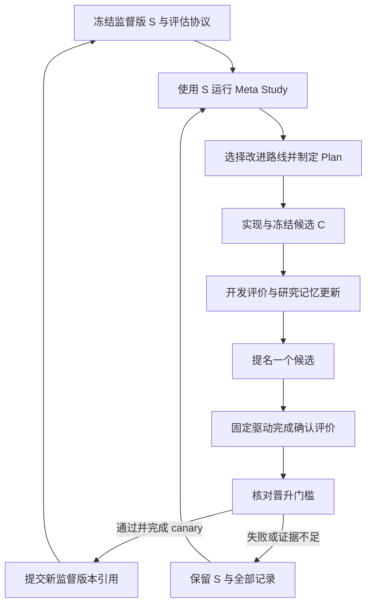

# Meta Loop 设计

状态：已实现策略配置候选、固定版本驱动与单批晋升控制；真实开发对照见 [Meta Loop 实现与验证](meta-loop-verification.md)。日期：2026-11-01。正式确认任务适配、操作系统读取隔离与下一批确认资源续接尚未实现。

Meta Loop 使用现有 research loop 研究自身的策略与组件。当前监督版本组织提案、候选实现和证据分析；独立、固定的评估与晋升逻辑决定是否将候选变为下一监督版本。每次版本替换都在一轮结束后生效，历史代码、研究记忆和评价记录可恢复。

## 首个目标

在保持任务质量、有效提交和证据协议的条件下，降低内层研究循环的路线选择与 Review 开销，并降低完整闭环耗时。

当前 Cactus 接线记录中，选择阶段 CLI 时间为 157.91 秒，Review 为 81.60 秒，闭环为 386.29 秒，实际训练约 3.14 秒。这些是定位优化方向的观测，不是晋升基线；正式对照重新测量监督版与候选版。[实测依据](verification-v2.md)

首版候选可修改选择策略、相关提示词、上下文装配和 Review 的读取与表达方式。候选可以减少角色调用、重复读取和无关上下文，但须保留调查合同、实际证据核查、研究记忆更新和恢复能力。首版保持 Plan → Execute → Review 边界及一次独立 Review，固定模型、推理强度、工具权限和内层训练预算。

## 版本与职责

| 对象 | 职责与记录 |
| --- | --- |
| 初始参考版 A0 | 当前已通过测试与真实接线的实现快照；作为长期质量下限，不视为已证明的最优版本 |
| 监督版 S | 当前允许组织元研究的准确代码与配置版本，由 `supervisor_ref` 指定；初始 S=A0 |
| 候选版 C | 从 S 派生的隔离代码版本，附修改范围、预期效果和证据引用；冻结后才能评估 |
| 固定驱动 | 版本启动、权限、总预算、可信测量、评分、晋升、回滚与恢复；候选无权修改 |
| 固定评估协议 | 任务、数据角色、资源、指标、容差和判定规则，使用不可变的 `protocol_ref` |

一个版本引用包含代码 commit、策略配置、依赖与运行环境引用、支持的协议版本。复制后的实现快照需先登记为可恢复版本。模型请求与推理设置属于本批固定条件，不因更换监督版而自动改变。

每个候选的修改起点必须等于本轮冻结的 S。其他历史候选可作为证据；借用其代码时仍形成从 S 派生的新候选，并重新评价。候选冻结后修改任何代码或配置，产生新候选 ID，旧评价不沿用。

冻结由固定驱动在内层评价开始前完成，生成只读源码版本；评估输出写到源码目录外。晋升与下一次派生均使用 `candidate.json` 的冻结代码引用，不能用 Execute 结束后包含新增报告的目录快照替代已测试版本。

监督版本运行在只读版本目录，其 Execute 只能修改新候选 worktree。内层被测版本在独立子进程与工作区运行，不能修改监督版本、固定驱动、评分器或晋升记录，也不能读取其他 run 的研究记忆和预测。固定驱动不在自身进程内导入候选可修改的模块。

## 一轮元研究



一次 Meta iteration 研究一个候选。一个晋升批次内 S 保持不变，默认最多调查三个候选，再提名一个进入确认评价；确认阶段不得修改候选。未获提名的候选保留开发结果，不占用该批的确认反馈。

监督版负责提出修改、解释开发结果和推荐候选。推荐不能替代评估结果，候选也不裁定自身胜负。候选通过晋升后，固定驱动结束旧监督进程，下一轮从新版本启动，继承已发布的元研究文档与路线状态。

### 阶段上下文

| 阶段 | 默认读取 | 主要输出 |
| --- | --- | --- |
| Meta Route Selection | 元目标、S/A0 引用、开发评价摘要、元研究文档、路线索引与剩余预算 | 本轮值得调查的一项组件修改 |
| Meta Plan | 选中行动、S 源码与配置、相关轨迹、允许修改范围和固定评估协议 | 修改合同、预期影响、候选验收与测量需求 |
| Meta Execute | 冻结合同和 S 起点；候选 worktree；允许访问的开发任务与日志 | 版本差异、候选引用、开发测量及证据 |
| Meta Review | 原合同、实际差异、可信开发报告、此前路线与全局理解 | 知识变化、候选有效性、提名建议与完整研究文档 |
| 固定确认与晋升 | 冻结的 S/C/A0、封存任务清单、评分器、预算和晋升规则 | 确认回执、canary 回执、晋升或保留决定 |

元研究文档保存“哪种框架策略在什么条件下有效”，内层文档保存任务知识。各个内层 run 从相同准备状态独立开始，不继承上一 run 的 learned candidate、Frontier 或聊天记忆。需要回查时沿元实验 → 内层 run → 实际输出与版本引用读取，避免全量重读历史日志。

## 固定评估协议

每批开始前冻结任务清单、准备状态、数据划分、训练程序与预算、模型与工具配置、框架版本、环境配额、重复计划、顺序与卡位安排、成本口径及晋升阈值。候选可以改研究策略，不能改这些评估条件。

### 首版工作负载

| 层次 | 固定范围 | 用途 |
| --- | --- | --- |
| 协议检查 | 原有控制与 Frontier 测试；多路线、执行不完整、证据冲突、人工编辑与恢复案例 | 检查合同与版本行为；案例期望保存在固定测试端 |
| 开发评价 | Aerial Cactus 的固定调查与已公开轨迹；每个候选与 S 至少一个新配对 run | 检查修改能否降低开销，选择提名候选 |
| 确认评价 | Denoising Dirty Documents 与 Spooky Author Identification；每任务三个配对重复 | 检查候选在未用于本批调优的任务状态下的质量与效率 |
| 监督 canary | S 与 C 各完成一次受限元研究任务，提出可审计修改但不启动下一代训练 | 检查 C 能否承担下一轮监督职责，禁止递归展开 |

确认套件同时包含冷启动调查与具有多个可行方向的已有研究状态。具体任务状态、初始版本及允许行动在候选产生前登记，不在看到结果后选择容易获胜的状态。预置研究记录须来自真实、可恢复的参考执行；未试验的方向明确标注为待探索，不伪造历史证据。

当前 Cactus 的 private 成绩已经用于接线报告，该切分仅作为开发依据，不充当新的盲测证据。轨迹回放和已有产物可用于快速筛选，但不能替代确认阶段的真实运行。

确认任务的准备与训练接口、固定驱动和计量接口完成后才具备执行条件。现有 Cactus 单请求桥负责有限训练接线，不能直接当作已经具备多轮任务评估能力的 Meta evaluator。

### 数据与反馈

内层训练数据用于拟合，开发验证反馈用于该 run 的研究选择；内层最终评价由独立评分器在候选产物冻结后进行。固定驱动收集最终结果，研究版本不能自行读取标签或改换最终提交。

开发报告可供元 Agent 完整读取。确认阶段的逐任务质量结果、标签、未使用的任务状态与随机种子计划保存在隔离评估端；元 Agent 只收到资格决定、失败门槛类别和可审计回执引用。不得通过研究文档、错误日志或 Frontier 暴露这些原始结果。

同批全部 run 和最终产物冻结前，不发布确认反馈。决定与失败类别也属于反馈；被反馈的任务状态退出后续晋升确认池。后续确认使用未参与此前候选调优的保留任务，或事先封存且不是已反馈状态变体的新研究情境。更换种子、运行顺序、名称或重新切分同一数据，均不自动恢复确认独立性。重复运行可补充测量，但不能被计为新的盲测资源。

看过确认决定后不得修改同一个候选重试该套件。没有新的有效确认资源时停止晋升。人工可审计原始确认报告，但不将其用于同批候选调优。

### 对照与预算

确认在同一条件下配对运行 S 与 C。S 与 A0 不同时，还运行 A0，检查累计质量退化。相同任务与重复使用相同初始状态和训练种子表，随机轮换版本顺序及资源位置，记录共享服务器争用、缓存状态和模型服务异常。

首批预算默认值在执行前写入 Meta Study：最多三个开发候选、一个确认提名、一次晋升尝试；内层每 run 最多两个 iteration、20 次 CLI 调用和 1800 秒。最多并行两个内层 run，且仅使用实际获分配的资源。整批上限为 8 小时、600 次 CLI 调用及 4000 万个客户端报告输入加输出 token，先触及的边界生效。这些是首版预算上限，不是耗时或费用预测。

外层提案、代码修改、开发评价、重新测量 S/A0、确认、canary 和失败均记入元研究总成本。各内层 run 另有相同的模型用量与硬件配额，具体 token 上限在运行前按统一口径固定。CLI 进程数仅作调度边界，不能代替模型推理量；预算耗尽不代表候选获胜。

经固定驱动独立确认的基础设施故障，允许在总预算内重试整对一次，保留失败记录并使用相同合同。单个版本的框架错误按该版本失败处理。不能通过重复测量直至通过来选择结果。

## 指标与首版晋升门槛

每个内层 run 由外部观察器记录：

- `O`：路线选择区间与 Review 区间的墙钟总时长，包括阶段内等待、重试和控制器开销。选择区间结束于 Plan 开始，Review 区间结束于研究文档与视图发布完成。
- `T`：内层完整 run 从启动到最终候选冻结的墙钟时长。
- `B`：按固定 CLI usage 口径统计的输入加输出 token。输入包含缓存命中，缓存比例另报；不重复加上已包含在输出中的 reasoning token，也不把 B 当作账单金额。
- 任务最终质量、有效提交、协议检查结果、证据与版本引用完整性，以及实际资源消耗。

区间由固定驱动标记。并行调用按阶段真实墙钟计时，调用耗时累计值另报。将选择或核查改名移入其他阶段不能改变计量范围；完整 T 与 B 同时参与判定。缺失 usage、时钟或评分记录时，结果为证据不足，不默认为零开销。

对同批配对样本 i 定义 `rO_i=O(C,i)/O(S,i)`、`rT_i=T(C,i)/T(S,i)`、`rB_i=B(C,i)/B(S,i)`。监督值必须为可测的正值，否则该批不满足比较条件。样本等权，协议开始后不能删除失败 run 或改变权重。

首版门槛如下，均须通过：

| 门槛 | 固定判定 |
| --- | --- |
| 协议有效 | 所有必需检查通过，所有确认 run 有效完成，无越权、缺失证据或不可恢复产物 |
| 质量保持 | 各任务分别比较三个重复的平均质量，同时相对 S 与 A0 满足预定容差，不混合不同量纲 |
| 主要收益 | 六个确认配对的平均 `rO` ≤ 0.80，且至少五对 `rO` < 1 |
| 完整耗时 | 平均 `rT` ≤ 0.95；每个任务的 `rT` 中位数 ≤ 1.05 |
| 模型用量 | 平均 `rB` ≤ 1.05，且每个 run 均满足自己的绝对预算 |
| 可继续监督 | C 的监督 canary 完成，输出符合修改范围与证据合同，未启动递归研究 |

质量容差初版为：AUC 最多降低 0.002；RMSE 与 log loss 最多增加 1%。各任务对 S 与 A0 分别满足。AUC 用于开发 Cactus 及未来同类任务，当前两个确认任务使用对应误差容差。重新测量 A0 防止每代小幅容忍退化累积成大幅损失。

这些是操作性晋升标准，不是统计显著性或普适不退化的证明。不同阈值、任务或预算须在新评估协议下重新冻结；候选与监督 Agent 无权事后放宽门槛。确认未通过或波动导致证据不足，保持 S。

## 晋升与监督交接

候选状态按 `proposed → frozen → dev_evaluated → nominated → confirmed → promoted` 推进，也可终结为 `rejected` 或 `inconclusive`。开发 Frontier 成员不自动获得晋升资格。

固定驱动先核对确认回执，再完成监督 canary，生成不可变晋升记录，包含旧 S、新 C、A0、协议、比较范围、实际结果引用和决定。提交前再次检查当前监督引用仍等于本批的 S；如已晋升或回滚，原结果作为历史保留，不能直接覆盖新监督版。

晋升发生在外层 iteration 已完成、没有执行中的版本切换时。先保存晋升清单，再原子更新监督指针；新监督进程只在提交完成后启动。新版本使用已发布元研究记忆，重新生成自己的工作区与会话，不加载旧进程中的隐式状态。

监督版负责下一轮研究，但固定驱动与评估协议仍保持原版本。首版只运行两层循环，canary 和内层实验不得自行启动第三层 Meta Loop。

## 回滚

以下情形撤销新监督版资格并触发回滚：

- 晋升所依赖的评价、产物版本或确认回执被证实无效。
- 新监督版出现可复现的权限、预算、收据、发布或恢复合同破坏。

晋升后的监测绑定该次晋升记录中的旧监督版本及 A0，不把新监督版与自己比较，也不要求反复证明 20% 的晋升改善。首版成本或任务质量监测不佳时，暂停后续晋升并创建诊断调查，不能直接凭波动自动回滚。调查若证实晋升依据失效或出现可复现的合同破坏，按上述规则回滚；人工也可依据归档调查显式选择合格历史版本回滚。

独立的网络或模型服务故障先作为基础设施事件记录，不凭单次异常归因于版本。若涉及数据或控制状态的合同破坏，立即停止启动新工作，保留现场。

固定驱动优先恢复最近一个未撤销且满足当前协议与运行接口的监督版本；若没有，则保持停止状态等待处理。回滚生成新记录，不删除原晋升或实验，也不覆盖任何预测、checkpoint 或研究文档。回滚不自动重跑已经发生的外部操作。

在途 run 始终绑定启动时的版本，不能热切换代码。正常可收尾的 run 完成后归档；需要终止的仅由固定驱动处理自己的任务，未知效果继续按现有显式核对规则恢复。被撤销版本的在途结果不能用于晋升。

## 复用现有 research loop

| 现有部分 | Meta Loop 中的用途 |
| --- | --- |
| Study 与 goal | 保存元目标、允许修改范围、评估协议和总预算 |
| Route | 组织选择策略、Review 上下文与证据读取等改进方向 |
| Experiment DAG | 节点对应候选框架版本及其评价；起点为本批 S，引用其他候选的经验 |
| Plan → Execute → Review | 冻结修改合同，产生候选并获取开发证据，更新元研究理解与提名建议 |
| Global Frontier | 在同一比较范围内保存通过开发资格检查、开销非支配的框架候选 |
| Local Frontier | 保存路线内的延迟、token、上下文大小和协议通过情况；观察量不自动成为全局目标 |
| Git worktree、attempt、publication | 候选隔离、调用收据、证据快照与研究记忆的一致发布 |
| 可信训练桥与外部评分器 | 扩展为受预算约束的内层评估入口；保持标签、实际测量和决定在固定驱动控制下 |

Meta Global Frontier 的主目标为 `mean_rO` 最小化，质量、完整耗时、token 和协议有效性作为资格约束。比较范围包含 S、协议、任务状态与重复批次引用；不能把对不同监督版本或任务集合得到的加速比放在同一 Frontier 排名。

累计效率收益在同一当前批次重新比较 C 与 A0，不将不同批次的相对加速比连乘。

确认数据不进入可供研究 Agent 查询的 Frontier。该视图组织开发候选；监督指针由确认与晋升规则维护。回滚或评价纠正时撤销相应资格，原始测量继续保留。

`strategy.py` 提供选择策略与 Review 提示入口。首个实现只允许修改 `selection=debate/direct` 与 `review=full/concise` 的配置；源码与固定驱动由版本快照保存，候选不能替换任意 Python 模块。`direct` 保留两个独立提案和 Judge，省略质疑与回应；`concise` 保留完整证据、输出字段与独立 Review，只要求减少重复表达。`_call` 的预算和收据、协议验证、版本管理、Frontier 数学关系与 `_publish` 的一致性逻辑由固定驱动持有。普通 Study 复用同一引擎，默认行为保持原策略。

`meta.py` 负责版本冻结、内层作业预算与回执、评估接纳、提名、晋升和回滚。CLI 提供 `meta init/status/decide/rollback`；可信 runner 调用 Python 接口冻结候选与提交评估。一个实例管理一个不可变评估批次，不自动续接新确认资源或启动下一代监督进程。开发协议不能晋升；正式晋升接口要求完整确认资源、已验证的读取隔离和外层发布清单。

## 持久化与恢复

```text
meta-study/
  goal.md / study.json / state.json
  research.md / frontiers.json
  routes/                            复用现有路线与文档
  meta.json                          A0、监督引用、批次、协议及全局预算游标
  iterations/0001/
    context/                         冻结的 S、协议与研究上下文
    selection.json / plan.md / execute.md / review.md
    workspace/                       候选源码 worktree
    candidate.json                   冻结代码、配置、差异及父版本引用
    evaluation/                      只含可公开开发报告和确认回执
    publication.json                 复用元研究文档发布清单
  promotions/                        不可变晋升与回滚清单
```

确认清单、标签与原始评分保存在 Agent 无法读取的评估环境，内层各 run 有独立的普通 Study 和工作区。通过作业 ID 与不可变版本引用关联，不复制整份数据或哈希模型、数据集作验证。

每次调用和评估作业提交前持久化身份、版本与预算；成功收据恢复后接纳结果，不重新提交训练。未知效果先核对，重试不增加独立证据数。元研究发布和监督指针提交分别有清单；后者只能在前者完成且评估门槛通过后提交。

晋升或回滚中断时，只允许将监督指针从记录的旧引用补齐为新引用，或接纳已提交的新引用。指针指向第三个版本时停下处理，不覆盖。恢复后按记录中的精确版本启动，不根据当前目录内容猜测版本。

## 验收条件

- 一个候选确实从本批 S 派生，冻结后修改不会沿用旧成绩；运行中的监督代码不被候选覆盖。
- 减少选择或 Review 开销但质量、总耗时或 token 门槛失败时，不能晋升。
- 不同代际的加速比按比较范围隔离；累计质量退化受 A0 约束。
- 确认只接收已提名的冻结候选，反馈不用于同批其他候选调优。
- 候选符合任务指标但破坏研究记忆或恢复合同，协议检查或监督 canary 会拒绝晋升。
- 晋升后新进程使用 C 和已发布元记忆；旧 S、全部候选和来源保持可恢复。
- 晋升中断不产生两个有效监督引用；回滚不删除历史或重复未知副作用。
- 没有新确认资源、预算不足或证据不足时保持当前监督版本，不自动放宽合同。
