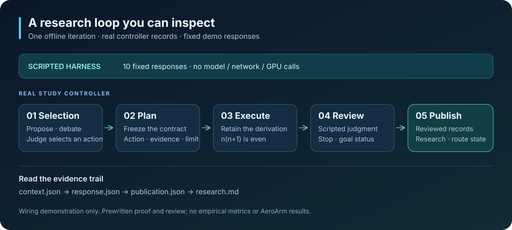

# Offline walkthrough

Run one complete controller iteration with fixed, labeled responses. The example
uses the elementary goal in [proof-goal.md](../examples/proof-goal.md): prove that
`n²+n` is even for every nonnegative integer `n`.



## Run

From the repository root, with Python 3.11+ and `uv` installed:

```sh
uv run python examples/offline_demo.py
```

The script calls the real `initialize()` and `Study.run(iterations=1)` with a
`ScriptedHarness` implementing `AgentHarness`. It never starts Codex, Pi, training,
GPU work, or a network request. Initial `uv` environment setup can require downloads;
once dependencies are available locally, run with
`uv run --offline python examples/offline_demo.py` to forbid setup downloads too.

Expected console output (the absolute output path varies):

```text
SCRIPTED OFFLINE DEMO · no model / network / GPU calls
Real controller: selection → plan → execute → review → publication
Published: 1 reviewed iteration · 10 scripted calls
State: stopped · goal_status=met (scripted)
Records: /path/to/research_loop/studies/demo
Inspect: state.json · iterations/0001/publication.json · research.md
```

The default output is `studies/demo`. Any existing output directory, including an
empty one, is refused with exit code 2. Choose a fresh path to run again:

```sh
uv run --offline python examples/offline_demo.py --output studies/demo-next
```

## Inspect the records

All paths below are relative to the generated output directory. The paths in
`state.json` identify the accepted call records; each attempt retains its frozen
`context.json`, `prompt.md`, `response.json`, `process.json`, and `completed.json`.

| Record | Fields or content to inspect |
| --- | --- |
| `state.json` | `iteration: 1`, `phase: "done"`, `status: "stopped"`, `call_count: 10`, `stop_reason: "review"`; `plan_ref`, `execution_ref`, and `review_ref` locate stage responses. |
| `iterations/0001/selection.json` | `rounds["0"].proposals` and `rounds["0"].judge` retain the two proposals and the fixed selection. |
| `iterations/0001/plan/attempt-001/response.json` | `contract` freezes the action, evaluation, decision criteria, required evidence, and timeout before Execute. |
| `iterations/0001/execute/attempt-001/response.json` | `markdown` contains the prewritten proof; `artifacts` and `measurements` are empty arrays. |
| `iterations/0001/review/attempt-001/response.json` | The scripted `goal_status: "met"` and `decision: "stop"` are separate judgments; `candidate_reviews` is empty. |
| `iterations/0001/publication.json` | `metadata.status: "reviewed"`, `state_after`, and `writes` record the controller's publication bundle. |
| `research.md` and `routes/R0001/research.md` | The controller publishes the labeled research texts supplied by Review. |
| `frontiers.json` | `global` and `local` remain empty: this qualitative example has no evaluations or measured candidates. |

The ten calls are two proposals, two critiques, two responses, one Judge, one Plan,
one Execute, and one Review. These are harness invocations counted by the controller,
not model requests. `process.json` explicitly records
`backend: "scripted-offline-demo"` and `model_called: false`. The model settings in
`study.json` are unused initialization defaults for this injected harness.

## What this demonstrates

The retained controller records, schema validation, stage ordering, call accounting,
and publication are real. Every proposal, critique, judgment, proof, and research
text is prewritten demo data, marked `[SCRIPTED OFFLINE DEMO]`. Review is not an
independent mathematical check, and `goal_status` is not a verified research score.
No measurements, benchmark results, or AeroArm experiments are claimed.

The proof is human-readable: one of two consecutive integers is even, so their
product is even. Its purpose here is to make the orchestration inspectable without
credentials, datasets, or compute. Live agent behavior and empirical research
quality require separate evaluation.

The [SVG flow diagram](assets/offline-flow.svg) is self-contained and can also be
embedded from the repository README with ``.

For a self-contained interactive walkthrough, open [showcase.html](showcase.html)
by downloading it and opening it locally in a browser. GitHub's file view does not
host the interactive page. It displays fixed example fields, runs no Study, and
needs no server or network connection.
