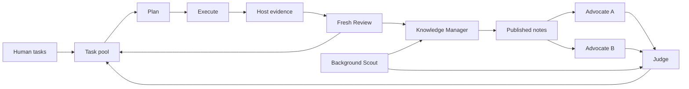

# Agents SDK research orchestration

This package provides process-local research orchestration with the Python
Agents SDK. Applications supply task-specific tools, evidence collection and
resource authorization. Explicit application-authorized safe handoffs can
continue a Study; arbitrary crash recovery is outside this package.

A [Codex role backend](CODEX.md) can run these roles with Codex subscription
authentication, native project tools, validated submissions and human summaries
while retaining the application-owned scheduler and resource contracts.

## Run

Python 3.12 and uv are required. The package supports Python versions >=3.12
and <3.13. The lock includes the SDK and SOCKS transport support for standard
proxy environment configuration. From the repository root:

```sh
uv sync --locked --project python
uv run --locked --project python python benchmarks/sdk_coding/run.py /path/to/new-private-run
```

The [coding demo](../benchmarks/sdk_coding/README.md) uses scripted model responses
and real local test subprocesses. It requires macOS `sandbox-exec`; it makes no
model API, GPU or remote requests. The directory must be new and outside Git.
Explicit external model configuration is described in that guide; provider
tool/structured-output compatibility needs its own authorized verification.

## Execution contract



- By default two Advocates receive the same captured pool/evidence context and run in
  parallel. Judge waits for both outcomes, including individual failures. At
  least one successful proposal is required to call Judge.
- Judge applies ordered `create/update/cancel` changes. Omitted tasks are retained.
  Updates/cancellations require the captured and current revision to match and
  the task to remain pending and autonomous. Human, running and reviewed tasks
  are protected. IDs remain reserved after cancellation. Conflicting entries
  are reported while unrelated valid changes apply.
- The bounded pool counts pending tasks, including pending dependency waits.
  In-place correction and external-blocked states do not consume proposal capacity.
  An explicit safe handoff can restore already-admitted continuations as `resuming`;
  these keep their prior admission, precede fresh pending work and cannot be edited
  by Judge. They do not enlarge the hard cap on new pending proposals. Within each
  group, ready human tasks precede autonomous tasks, then lower numeric priority and ID. Dependencies
  become ready after prerequisite Review publication, including reviewed negative
  results; an execution summary alone does not unblock a task.
- Each claimed task gets its own native Plan, Execute and Review Agents and
  application-scoped tools. Plan is frozen before execution. Review receives
  the frozen Plan, trusted development evidence, public Execute summary, prior
  reviewed records and advisory notes/Scout information. Every initial call starts with
  explicit input and no SDK Session or previous response ID; a corrected stage
  can continue its own SDK history. Execute's hidden conversation is not inherited by Review.
- Applications can supply `prepare_input(agent, payload)` to `run_research` to
  publish each controller-generated role input in a private knowledge store and
  return only a retrieval reference to the Agent. Attach read-only knowledge
  tools to every role so Agents retrieve context themselves. The callback runs
  once per role invocation, before `Runner.run`, not per model/tool turn. It must
  preserve frozen input and evidence identities; it does not change controller
  acceptance checks or authorize computation. Without it, explicit inputs remain
  unchanged. This is an input boundary, not a bundled knowledge service or
  process-recovery mechanism.
- Investigation concurrency and experiment concurrency are separate. The
  controller gates host evaluation with an `asyncio.Semaphore`. Application
  Execute tools must use that same supplied semaphore around experiments; the
  demo does so. The semaphore is process-local, not an external resource quota.
- Scout runs independently, supplies advisory sources and limitations, and cannot
  alter active Plans or evaluations. The demo retrieves synthetic local material;
  it does not demonstrate live web research.
- A single background Knowledge Manager consumes frozen Review outcomes and Scout
  reports. Incomplete delivery is explicitly labeled and is not an accepted
  scientific result. Arrivals during a call remain for the next batch. It
  atomically replaces one Markdown file; investigations can continue before notes
  publish. Each phase reads current published notes at its call boundary. Records
  remain authoritative and can directly inform dependent tasks.
- The default publication above is one Markdown file. For a Study-wide file
  library, applications can set `knowledge_path` to their live Index and supply
  `publish_knowledge(final_output)`. With that callback the workflow archives
  the final response but **does not write to the live path**: the application
  exclusively publishes the Manager's complete private draft, for example by
  atomically activating a versioned directory. Give only Manager draft edit
  tools; all roles read the published tree independently of any Index. Keep
  immutable experiment/literature Evidence outside the editable tree. The
  application must serialize baseline validation and activation and advance its
  Evidence acknowledgment cursor only with successful activation; a rejected
  draft leaves Evidence pending. This callback does not supply a database or
  DBOS recovery mechanism.
- Initial work, new Reviews, Scout reports and successful knowledge publications
  trigger coalesced planning. Judge edits do not trigger another round. Finite
  demo defaults remain 3 investigations, 2 simultaneous investigations, 1 experiment,
  4 planning rounds and 2 Scout runs. Set `max_rounds`, `max_planning_rounds` and
  `max_scout_runs` to `None` for an application-owned continuous Study. These are
  admission limits, never scientific success conditions or a spending cap.
- Review/Judge stops are scoped candidates. They never directly close admission.
  Optional async `confirm_stop(candidate, current_context)` performs the independent
  whole-Study judgment at a quiescent boundary, after all ready work and knowledge
  publication. The candidate retains its original context; the callback receives
  current pool/evidence/notes and must reevaluate stale evidence and unresolved
  required tasks. Only an accepted, unchanged current snapshot establishes
  `goal-achieved`. A changed snapshot resumes scheduling before another decision.
  Without confirmation, a task achievement cannot establish Study completion:
  the latest Review supplies its non-achieved goal, or `unknown` for a local
  achievement.
- Optional async `recover_stage(StageFailure)` receives the exact phase, task,
  directory, exception, input, output and SDK `run_data`. Return
  `RecoveryDecision("retry", reason, progress_key, retry_after=...)` only after
  a verified new action/condition, or `RecoveryDecision("blocked", reason, wakeup=...)`
  with a named external condition. A wakeup callback waits for that condition and
  diagnosis runs again. Without a wakeup the task remains blocked. Repeating the
  same phase/error/progress key blocks across task aliases. Diagnosis must ground
  progress keys in actual changes; arbitrary new strings do not prove progress.
  No generic retry quota or automatic whole-experiment replay is added.
- Corrected role stages receive their original SDK history plus exact error/output
  feedback. Confirmed tool outputs remain present; unresolved tool calls require
  application-reconciled `continuation_input` before continuation. Native SDK
  invalid-final-output and max-turn handlers capture the run snapshot before
  error redaction, preserve failure and pass it to diagnosis without inventing
  a scientific output or automatically resetting a role's quota. Other failures require
  SDK history or explicitly reconciled continuation. A successful
  Execute/collection is archived in `completed-execution.json` before Review, and
  Review errors retry only Review. Cancellation and fatal errors still propagate.
  Without a recovery callback ordinary failures stay isolated, with `error.json`
  and `ResearchResult.failures`; independent tasks continue.
- A Plan freezes `execution_kind` (`analysis` by default, or `measurement`) and
  `required_artifacts`, with optional `numeric_fields` pointing to selected small
  numeric summaries (for example `summary.json#/delta`). The application verifies
  actual execution and artifact receipts against that frozen delivery through its
  host evidence callback.
- A Review can set `delivery_complete=false`. Host `execution_complete` and `valid`,
  that flag and optional `assess_completion(record)` must all pass before completion
  releases dependencies. Missing evidence is published as an incomplete Review and enters
  recovery phase `delivery`, whose output is the original Record. Only this phase
  permits `RecoveryDecision.restart_from="plan"` or `"execute"`: the same task's
  revision archives the old artifacts and supplies prior output/Review as correction
  context. With no restart selection it re-collects host evidence and reviews it.
  True measured negative results may complete; absence of a number cannot stand
  in for the frozen quantitative delivery. The application defines that delivery.
- Optional `validate_evidence_refs(refs, reviewed_records)` resolves exact immutable
  evidence provenance, including application-owned prior reviewed sources. Raise
  on false or unreviewed sources; no suffix-based identity guessing is performed.
  The default accepts only exact current Record IDs.
- Knowledge failures retain published notes and pending Evidence, archive the failed
  frozen batch and retry through diagnosis or with the next new evidence batch.
  Publication alone advances the pending cursor. Failure does not trigger empty
  planning or an immediate Manager replay. Inspect `pending_knowledge`, `failures`
  and pool states before interpreting completion.
- `should_drain(context)` latches a requested drain before the next task, planning
  or Scout admission; existing work and knowledge publication finish. Then
  `on_quiescent(context)` can seal a planned safe handoff only when no role,
  investigation or knowledge batch is active/pending; true returns `stopped="handoff"`.
  The application owns the handoff receipt, resource reconciliation and single-writer
  activation. Restore only that explicit receipt with `TaskPool.from_snapshot`,
  `initial_records` and `initial_scout_reports`. Active task snapshots are rejected.
  Initial reviewed IDs must be unique; repaired IDs retain their investigation's
  sequence so subsequent records cannot reuse them.
  `initial_stage_inputs` restores exact SDK role history once, keyed by task ID
  with `phase` and `input`. Execute continuation requires its frozen `plan`;
  Review continuation requires `completed_execution`. Completed execution cannot
  resume as Execute. Tool-enabled failures without SDK history require explicit
  reconciled continuation input before retry.
  A `collect_evidence` entry requires the frozen `plan` and confirmed
  `execute_summary`; it resumes host collection without calling Plan or Execute.
  This is not arbitrary process-crash recovery. Optional async `idle_wait(context)`
  can wait for an actual external event when an unlimited Study has no runnable
  work; true reopens planning, false returns its current empty/blocked disposition.
  The workflow does not install recurring model polling.
- Applications must raise generic `FatalResearchError` when further dispatch is
  unsafe, including unknown external resource effects. Fatal errors are detected
  through SDK exception causes/contexts and abort the whole run, as do cancellation
  and other `BaseException` signals. Owned coroutines are cancelled and joined;
  accepted artifacts and prior notes remain. A fatal run's pool may retain
  unsettled claimed tasks. These files never authorize replay or establish that
  external processes stopped. The controller cannot infer unknown resource state
  from an arbitrary ordinary exception; adapters own that fatal classification.

## Application-authorized Review-only continuation

An adapter may explicitly supply `Investigation.completed_execution` as a frozen
`CompletedExecution(plan=..., execute_summary=..., evidence=...)` when execution
has finished and only a fresh independent Review is needed. The adapter owns
input authorization and reconciliation of external resource state before preparing
this investigation. Use the exact frozen Plan, public Execute summary and trusted
host-collected evidence; do not replace evidence validity with execution completion.

The controller requires `evidence.execution_complete=true` and applies the same
`Plan.based_on` check or configured exact provenance resolver. Prior-study sources
require explicit application authorization; they are not accepted by string shape. It copies the Plan,
evidence and `completed-execution.json` into the new record directory, skips the
Planner, Execute and evidence callback, and calls Review with the normal shared
context. Review receives no private Execute history. Ordinary Review failure remains
isolated to that task and does not release its dependents.

This is an explicit application-supplied continuation in a new process-local study,
not automatic discovery, replay, whole-study recovery or DBOS durability. Existing
files alone never authorize execution or continuation. With `completed_execution=None`
(the default), the ordinary Plan/Execute/evidence/Review path is unchanged.

## Code and trace

[workflow.py](src/research_loop/workflow.py) contains ordinary asyncio research
policy and native `Runner.run` calls. `ResearchAgents` groups native Agent
objects; `prepare` supplies each task's native Agents, scoped tools and trusted
evidence callback. [task_pool.py](src/research_loop/task_pool.py) owns only research
task state. Task-specific code and metrics belong in adapters/benchmarks.

Call `configure_local_tracing(path)` before the first SDK call in a standalone
worker. It installs a native SDK provider containing only the local JSONL
processor, without constructing the cloud exporter. [tracing.py](src/research_loop/tracing.py)
records trace/span start/end IDs, times, role outputs, tools/results, errors and
SDK-boundary model inputs, instructions, function schemas and settings. These
are application observations, not complete HTTP payloads or physical request
counts. Trace configuration is process-global. Inputs/source may be private;
keep all runtime files outside commits. Abrupt exit can leave incomplete traces.
No trace server, UI or second execution journal is introduced.

## Verification

```sh
uv run --locked --project python pytest -q python/tests
uvx ruff format python/src python/tests benchmarks/sdk_coding
uvx ruff check python/src python/tests benchmarks/sdk_coding
```

The coding demo uses synthetic model responses and a synthetic Scout source.
Live model decisions, web retrieval, arbitrary crash recovery, external resources
and other execution platforms require separate verification.
