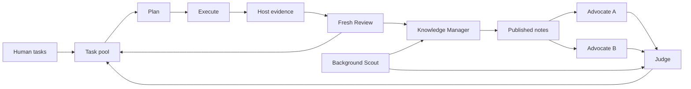

# Agents SDK research orchestration

This is the first implementation slice of [#107](https://github.com/Chen-HongRu/research_loop/issues/107).
The current scope follows the user's 2026-11-07 request: the complete role
topology, implemented directly with Python Agents SDK, and basic local tracing.
The existing Node/PiDurable entry remains available. This package starts new
process-local studies; it does not migrate or resume existing Studies.

## Run

Python 3.12 and uv are required. From the repository root:

```sh
uv sync --locked --project python
uv run --locked --project python python benchmarks/sdk_coding/run.py /path/to/new-private-run
```

The [coding demo](../benchmarks/sdk_coding/README.md) uses scripted model responses
and real local test subprocesses. It requires macOS `sandbox-exec`; it makes no
model API, GPU or remote requests. The directory must be new and outside Git.
Explicit external model configuration is described in that guide; provider
tool/structured-output compatibility needs its own authorized verification.

## Execution contract



- Two Advocates receive the same captured pool/evidence context and run in
  parallel. Judge waits for both outcomes, including individual failures. At
  least one successful proposal is required to call Judge.
- Judge applies ordered `create/update/cancel` changes. Omitted tasks are retained.
  Updates/cancellations require the captured and current revision to match and
  the task to remain pending and autonomous. Human, running and reviewed tasks
  are protected. IDs remain reserved after cancellation. Conflicting entries
  are reported while unrelated valid changes apply.
- The bounded pool counts all pending tasks, including blocked ones. Ready human
  tasks precede autonomous tasks, then lower numeric priority and ID. Dependencies
  become ready after prerequisite Review publication, including reviewed negative
  results; an execution summary alone does not unblock a task.
- Each claimed task gets its own native Plan, Execute and Review Agents and
  application-scoped tools. Plan is frozen before execution. Review receives
  the frozen Plan, trusted development evidence, public Execute summary, prior
  reviewed records and advisory notes/Scout information. Every call starts with
  explicit input and no SDK Session or previous response ID; Execute's hidden
  conversation is not inherited by Review.
- Investigation concurrency and experiment concurrency are separate. The
  controller gates host evaluation with an `asyncio.Semaphore`. Application
  Execute tools must use that same supplied semaphore around experiments; the
  demo does so. The semaphore is process-local, not an external resource quota.
- Scout runs independently, supplies advisory sources and limitations, and cannot
  alter active Plans or evaluations. The demo retrieves synthetic local material;
  it does not demonstrate live web research.
- A single background Knowledge Manager consumes frozen batches of accepted
  Review/Scout inputs. Arrivals during a call remain for the next batch. It
  atomically replaces one Markdown file; investigations can continue before notes
  publish. Each phase reads current published notes at its call boundary. Records
  remain authoritative and can directly inform dependent tasks.
- Initial work, new Reviews, Scout reports and knowledge publications trigger
  bounded, coalesced planning. Judge's own changes do not trigger another round.
  Defaults limit investigations to 3, simultaneous investigations to 2,
  experiments to 1, planning rounds to 4 and Scout runs to 2. These are admission
  limits, not success conditions or a provider spending cap.
- Judge/Review research stop closes new task admission; already claimed
  investigations finish and knowledge work drains. This is not an operator STOP
  API or a guarantee that cancellation terminates external processes. The first
  stop reason is retained. Round exhaustion never establishes goal achievement;
  `achieved` requires complete valid evidence and the minimum reviewed-round count.
- Scout/planning failures preserve existing tasks and write advisory errors.
  Plan, Execute, Review or Manager failure aborts the run without automatic retry;
  accepted artifacts and prior published notes remain. Owned coroutines are
  cancelled and joined. A failed run's pool may retain unsettled claimed tasks;
  those files do not authorize replay of unknown tool effects.

## Code and trace

[workflow.py](src/research_loop/workflow.py) contains ordinary asyncio research
policy and native `Runner.run` calls. `ResearchAgents` groups native Agent
objects; `prepare` supplies each task's native Agents, scoped tools and trusted
evidence callback. [task_pool.py](src/research_loop/task_pool.py) owns only research
task state. Task-specific code and metrics belong in adapters/benchmarks.

Call `configure_local_tracing(path)` before the first SDK call in a standalone
worker. It installs a native SDK provider containing only the local JSONL
processor, without constructing the cloud exporter. [tracing.py](src/research_loop/tracing.py)
records trace/span start/end IDs, times, role outputs, tools/results, errors and
SDK-boundary model inputs, instructions, function schemas and settings. These
are application observations, not complete HTTP payloads or physical request
counts. Trace configuration is process-global. Inputs/source may be private;
keep all runtime files outside commits. Abrupt exit can leave incomplete traces.
No trace server, UI or second execution journal is introduced.

DBOS integration is deferred: `DBOSRunner` checkpoints model responses, while
tool bodies require explicit durable boundaries. Whole-study recovery also
requires durable completion ordering, deterministic pool replay, frozen knowledge
inputs/batches and replay-safe publication. Adding a wrapper around this asyncio
loop would not provide those semantics. The SDK-only entry has no DBOS dependency.

## Verification

```sh
uv run --locked --project python pytest -q python/tests
uvx ruff format python/src python/tests benchmarks/sdk_coding
uvx ruff check python/src python/tests benchmarks/sdk_coding
```

Observed on the current implementation: 27 focused tests passed, including
parallel Advocate/investigation progress, dependency readiness, human protection,
stale Judge changes, separate experiment admission, asynchronous serial Manager,
fresh Review inputs and failure handling. The macOS coding smoke completed two
human investigations and one dependent autonomous investigation: five SDK test
tool calls returned `1, 1, 0, 0, 0`, and three independent host evaluations returned
zero. Local trace recorded all roles without errors. The demo ended at the round
limit with `goal=not-achieved`; a further admitted task remained pending.

The model responses and Scout source were synthetic. Live model decisions, web
retrieval, DBOS recovery, external resources and other execution platforms remain
unverified. These observations establish the local orchestration path, not a
general research benefit.
